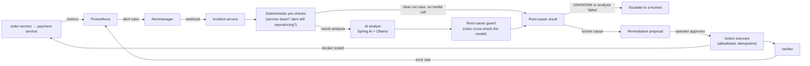

# Incident Commander

[](https://github.com/bhumisingh2605/incident-commander/actions/workflows/ci.yml)
[](LICENSE)


**An AI-assisted incident responder that investigates alerts with a local LLM and fixes problems only after a human approves.**

When Prometheus fires an alert, Incident Commander gathers evidence (health checks, metrics, dependencies, logs, recent deployments), asks a local model (Ollama, `qwen3:8b`) for a root cause, double-checks that answer with deterministic rules, and proposes a remediation. An operator approves it, Commander executes it, and then **verifies the fix worked**. When it isn't sure, it says `UNKNOWN` and escalates to a person instead of guessing.

<!-- After recording a 60-90 second screen capture (alert -> diagnosis -> approval -> restart -> verified), save it as docs/demo.gif and uncomment:

-->

## How it works



1. Alertmanager posts a firing alert to Commander, which opens (or joins) an incident.
2. Cheap, deterministic checks run first. If a service simply isn't answering health checks, or the alert has stopped reproducing, no model call is needed.
3. Otherwise the AI analyst collects evidence through tools and proposes a root cause.
4. The root-cause guard cross-checks the answer against live telemetry and corrects or downgrades it.
5. A remediation proposal is created for known causes. Uncertain or failed analyses are escalated instead.
6. An operator approves or rejects the proposal. Approval executes it immediately.
7. The verifier re-checks the error rate after the action; the incident resolves when the alerts clear.

## Safety model

The model is treated as untrusted. Everything it produces passes through code that can overrule it.

| Control | What it does |
|---|---|
| Honest uncertainty | The analyst may return `UNKNOWN`. Unknown or failed analyses become `ESCALATED` and are never auto-resolved |
| Root-cause guard | Deterministic rules override the model when telemetry contradicts it (false alarms, wrongly blamed downstream latency, dependency and service-down cases) |
| Allowlisted actions | Only `RESTART_SERVICE` and `ROLLBACK_DEPLOY` on registered services, checked when proposed **and again at execution**. The target must be a registered service name; commands are never built from free text |
| Human approval | Operators approve or reject. Viewers are read-only; the webhook login can only post alerts |
| Idempotent execution | A claim step prevents double execution; a per-service cooldown (5 min) stops restart loops |
| Expiry | Approvals expire after 15 min and pending proposals after 60 min; stuck executions are recovered |
| Post-fix verification | Up to three error-rate checks (after 90 s, 45 s, 45 s) before the fix is considered successful |
| Bounded analysis | Each investigation has an overall deadline (default 10 min) and one retry if the model server is unreachable; failures escalate with a visible reason |
| Audit trail | Every tool call, API call and proposal/incident event is recorded and queryable |
| Locked-down surface | HTTP Basic with three roles, 12-character minimum passwords, debug endpoints disabled by default |

## Quick start

**Prerequisites:** Docker, [Ollama](https://ollama.com), `curl` and `python3` (for the demo script). Java 21 is only needed to run the tests locally.

### Linux / macOS / Git Bash

```bash
git clone https://github.com/bhumisingh2605/incident-commander.git
cd incident-commander

ollama pull qwen3:8b      # keep Ollama running
make up                   # creates .env with random passwords on first run, then builds and starts everything
make demo                 # breaks payment-service and walks you through the incident
```

`make help` lists every task. Open the dashboard at <http://localhost:8080/ui/index.html> and log in as `viewer` or `operator` (passwords are in `.env`).

### Windows (PowerShell)

```powershell
git clone https://github.com/bhumisingh2605/incident-commander.git
cd incident-commander

ollama pull qwen3:8b
.\scripts\setup-secrets.ps1
. .\.env.ps1
docker compose -f docker-compose.yml -f docker-compose.full.yml up -d --build
```

Then follow the scenario instructions below to trigger incidents.

### What the demo does

`make demo` injects a fault into `payment-service`, sends order traffic until Prometheus fires an alert, waits for the AI diagnosis, shows you the proposed restart, and (on your approval) executes it and waits for the incident to resolve. A local 8B model takes a few minutes to investigate; that's expected.

### Troubleshooting

- **Commander can't reach Ollama on Linux:** Ollama listens on localhost only by default. Start it with `OLLAMA_HOST=0.0.0.0 ollama serve` so containers can reach it.
- **Incident ends `ESCALATED` with "model could not be reached":** Ollama isn't running or `qwen3:8b` isn't pulled.
- **Changed `DB_PASSWORD` and the database won't start:** run `make clean` to recreate the database volume.

## Evaluation

The analyst is tested against 12 failure scenarios on the sample order and payment services, including deliberate red herrings and false alarms (where the correct answer is `UNKNOWN`).

| ID | Scenario | Expected diagnosis |
|---|---|---|
| S1 | Payment deploy, then payment errors | payment-service: bad deploy / application error |
| S2 | Payment errors, no recent deploy | payment-service: application error / dependency failure |
| S3 | Payment slow | payment-service: slow dependency |
| S4 | Order-service errors, payment healthy | order-service: application error |
| S5 | Payment container stopped | payment-service: service down |
| S6 | Payment memory leak | payment-service: resource exhaustion |
| S7 | Red herring: order deploy, payment errors | payment-service (not the recent deploy) |
| S8 | False alarm, system healthy | `UNKNOWN` |
| S9 | Order-service slow, payment healthy | order-service |
| S10 | Order-service memory leak | order-service: resource exhaustion |
| S11 | Order deploy, then order errors | order-service: bad deploy / application error |
| S12 | Latency false alarm, system healthy | `UNKNOWN` |

A run is correct when both the predicted service and an accepted category match. Local models are non-deterministic, so `scenarios/run-eval.ps1` repeats each scenario and reports pass rate and latency for a single prompt version:

```powershell
$env:SPRING_PROFILES_ACTIVE = "dev"      # the runner uses the /debug endpoints; start Commander with this set
. .\.env.ps1
.\scenarios\run-eval.ps1 -PromptVersion v3-guard -Runs 5
```

<!-- After running the batch, paste the "Overall" line and table from scenarios/eval/summary-*.md here. -->

Individual scenarios can be run with `scenarios/run-scenario.ps1 -Id S1`. Historical single-run results are in `scenarios/results.csv`.

## Testing

```bash
make test                       # unit + integration tests (Testcontainers needs Docker)
scripts/security-matrix.sh      # 153 role/permission checks against a running Commander
```

CI runs the Maven builds, container image builds and Compose validation on every push. On Windows, use `scripts/security-matrix.ps1` (add `-DebugEnabled` when Commander runs with `SPRING_PROFILES_ACTIVE=dev`).

## Tech stack

Java 21 · Spring Boot 4 · Spring AI · Ollama (`qwen3:8b`) · PostgreSQL 16 · Flyway · Prometheus · Alertmanager · Docker Compose · Testcontainers · Maven

## Project layout

```text
commander/        Incident Commander (Spring Boot): API, analyst, guardrails, remediation, dashboard
services/         Sample order-service and payment-service with chaos endpoints
infra/            Prometheus rules and Alertmanager configuration
scenarios/        12 failure scenarios, runner and evaluation tooling
scripts/          Secrets setup, security matrix and demo (bash + PowerShell)
docs/             API reference and configuration guide
```

## Documentation

- [API reference](docs/API.md): endpoints, roles, status codes, examples
- [Configuration](docs/CONFIGURATION.md): ports, environment variables, operational limits

## Known limitations

This is a local-first project, not a production incident platform.

- **Docker socket access:** remediation runs `docker restart` through the mounted Docker socket, which is powerful. Targets are allowlisted, but production use would call for a narrower mechanism such as the Kubernetes API.
- **Rollback is simulated:** `ROLLBACK_DEPLOY` needs two recorded deployments, then restarts the service and records the earlier version as the current one; it does not redeploy a previous image.
- **Single worker:** investigations run one at a time, so a burst of incidents queues behind slow model calls.
- **Basic auth over HTTP:** fine on localhost; put TLS and a real identity provider in front for anything shared.
- **Model accuracy is not guaranteed.** That is why every action needs approval and every fix is verified.

## License

[MIT](LICENSE)